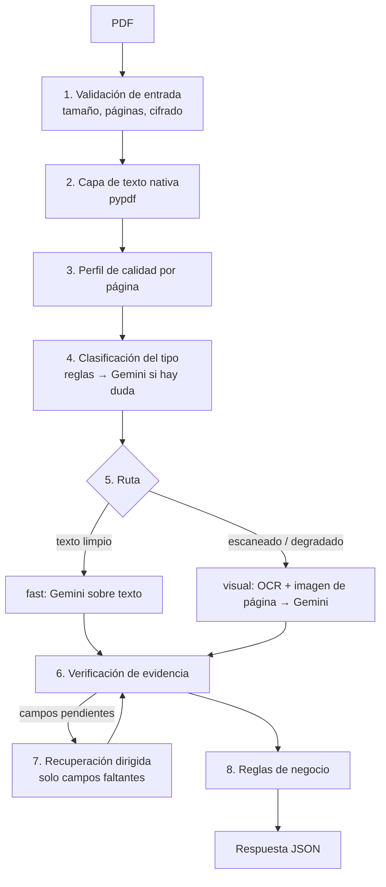

# smart-doc-extractor: Arquitectura

API que recibe un PDF y devuelve **datos estructurados y auditables**: cada valor trae su fuente, su evidencia y su nivel de confianza, y cada ausencia se explica.

Tipos de documento iniciales: **factura** y **CV**. Agregar otro tipo es definir su esquema y sus reglas, sin tocar el pipeline.

## 1. Principios

1. **El LLM extrae, Python decide.** Gemini lee y propone valores. Cálculos, validaciones y confianza final son código determinista.
2. **Lo gratis y exacto primero.** Si el PDF trae capa de texto, se usa. El OCR y la vía visual solo entran cuando hacen falta.
3. **Ningún valor sin evidencia.** Un valor que no se encuentra en el documento baja de confianza; no se publica como confiable.
4. **La ausencia se explica.** `value: null` siempre va con `missing_reason`.
5. **Sin imputación.** Nunca se rellenan valores "probables" (promedios, documentos anteriores).
6. **Se mide.** Cada cambio se evalúa contra un dataset con respuestas correctas.

## 2. Alcance

**Hace:** clasificación del tipo de documento, extracción por campo, validaciones de negocio, métricas de uso (tokens y latencia) y evaluación offline.

**No hace:** almacenamiento de documentos ni resultados, procesamiento por lotes, autenticación (se despliega privado con `cloudrun-private-auth`), ni documentos de más de 20 páginas.

## 3. Pipeline



| # | Etapa | Detalle |
|---|---|---|
| 1 | Validación de entrada | ≤ 10 MB, ≤ 20 páginas, PDF real (firma `%PDF`), sin contraseña. Si no se cumple, `4xx` |
| 2 | Capa de texto | Texto por página con `pypdf`. Es exacto y gratuito |
| 3 | Perfil de calidad | Por página: `digital`, `scanned` o `empty`, según caracteres extraídos por área y la proporción de imagen |
| 4 | Clasificación | Palabras clave por tipo. Si ninguna puntúa claro, una llamada corta a Gemini con un enum. Se puede forzar con `doc_type` |
| 5 | Ruta | `fast` si todas las páginas útiles son `digital`. Si no, `visual`: OCR (RapidOCR) más la imagen de la página como entrada multimodal |
| 6 | Verificación de evidencia | Cada valor se busca en el texto u OCR (ver §5). Asigna `confidence` |
| 7 | Recuperación dirigida | **Máximo una** segunda llamada, solo con los campos sin evidencia y el contexto de su zona |
| 8 | Reglas | Validaciones del tipo de documento (ver §6). No cambian valores: agregan resultados a `validations` |

Gemini se usa con **salida estructurada**: `response_schema` generado del modelo Pydantic del tipo de documento y `temperature=0`. La respuesta se valida con el mismo modelo; si no es válida, se reintenta una vez.

## 4. Contrato de la API

### `POST /extract` (`multipart/form-data`)

| Campo | Tipo | Requerido |
|---|---|---|
| `file` | PDF | sí |
| `doc_type` | `invoice` \| `resume` | no; si falta, se clasifica |

**Respuesta `200`** (abreviada)

```json
{
  "doc_type": { "value": "invoice", "method": "keywords", "confidence": "high" },
  "route": "fast",
  "pages": [{ "page": 1, "profile": "digital" }],
  "fields": {
    "invoice_number": {
      "value": "A-1042",
      "confidence": "high",
      "source": "text_layer",
      "evidence": { "page": 1, "snippet": "Factura No. A-1042" },
      "missing_reason": null
    },
    "due_date": {
      "value": null,
      "confidence": null,
      "source": null,
      "evidence": null,
      "missing_reason": "not_present"
    },
    "total": {
      "value": 1160.00,
      "confidence": "high",
      "source": "text_layer",
      "evidence": { "page": 1, "snippet": "TOTAL $1,160.00" },
      "missing_reason": null
    }
  },
  "validations": [
    { "rule": "subtotal_plus_tax_equals_total", "passed": true, "detail": null }
  ],
  "usage": { "llm_calls": 1, "input_tokens": 1830, "output_tokens": 240, "latency_ms": 2140 }
}
```

**Valores cerrados**

| Campo | Valores |
|---|---|
| `confidence` | `high` (evidencia literal), `medium` (evidencia parcial u OCR con baja confianza), `low` (sin evidencia) |
| `source` | `text_layer`, `ocr`, `vision`, `rule` |
| `missing_reason` | `not_present`, `illegible`, `insufficient_evidence`, `conflicting_candidates` |

Un campo derivado por regla (por ejemplo, `subtotal` calculado de las partidas) lleva `source: "rule"`, `evidence: null` y el nombre de la regla.

**Errores**

| Código | Cuándo |
|---|---|
| `413` | Más de 10 MB |
| `415` | No es PDF |
| `422` | Más de 20 páginas, PDF cifrado o `doc_type` desconocido |
| `502` | Gemini falló después del reintento |

### Otros

- `GET /health` → `{"status": "ok"}`
- `GET /doc-types` → tipos soportados con sus campos y reglas (generado de los modelos)
- `/docs` → Swagger

## 5. Verificación de evidencia

Depende del tipo de campo, porque un mismo método no sirve para todos:

| Tipo de campo | Ejemplos | Verificación |
|---|---|---|
| Identificador | número de factura, RFC, email | Coincidencia literal tras normalizar espacios y mayúsculas |
| Monto | subtotal, total | Se normaliza el formato (`$1,160.00` → `1160.00`) y se busca el número |
| Fecha | emisión, vencimiento | Se buscan sus componentes (día, mes, año) en cualquier formato común |
| Texto libre | nombre, dirección, puesto | Cobertura de tokens ≥ 80% (RapidFuzz) |

La búsqueda difusa **solo confirma o descarta** un valor propuesto; nunca genera valores.

## 6. Tipos de documento

Cada tipo vive en su propio módulo con tres piezas: **modelo Pydantic**, **palabras clave** de clasificación y **reglas**.

**Factura (`invoice`)**: emisor, receptor, RFC de ambos, número, fecha de emisión, fecha de vencimiento, moneda, partidas (descripción, cantidad, precio, importe), subtotal, impuestos, total.

| Regla | Comprueba |
|---|---|
| `subtotal_plus_tax_equals_total` | subtotal + impuestos = total (± 0.01) |
| `line_items_sum_to_subtotal` | Σ importes = subtotal (± 0.01) |
| `line_amount_consistency` | cantidad × precio = importe, por partida |
| `due_after_issue` | vencimiento ≥ emisión |
| `tax_id_format` | RFC con formato válido (12 o 13 caracteres) |

**CV (`resume`)**: nombre, email, teléfono, ubicación, resumen, experiencia (empresa, puesto, inicio, fin), educación, habilidades.

| Regla | Comprueba |
|---|---|
| `email_format` | Formato de email válido |
| `experience_dates_ordered` | inicio ≤ fin en cada experiencia |
| `no_future_dates` | ninguna fecha posterior a hoy |

## 7. Evaluación (`eval/`)

**Dataset sintético**: `scripts/generate_dataset.py` crea documentos con ReportLab y datos falsos (Faker, semilla fija). Cada documento se guarda con su `ground_truth.json`, en tres variantes:

| Variante | Cómo se genera |
|---|---|
| `clean` | PDF digital tal cual |
| `scanned` | Rasterizado a 150 dpi, ruido, rotación leve, sin capa de texto |
| `watermark` | `scanned` más una marca de agua diagonal |

Tamaño objetivo: 30 facturas y 20 CVs, por 3 variantes, para un total de 150 documentos.

**Métricas** (`eval/run_eval.py`), por campo y por variante:

| Métrica | Qué mide |
|---|---|
| Exactitud | valor normalizado = esperado |
| Tasa de alucinación | valor publicado cuando el esperado es `null` |
| Calibración | exactitud real de los valores con `confidence: high` |
| Costo y latencia | tokens y ms promedio por documento |

La salida es `eval/report.md`; la tabla resumen va en el README.

**Sin API key en CI**: el cliente LLM tiene una implementación grabada (`RecordedLLM`) que reproduce respuestas guardadas. CI corre la evaluación completa sin red; con una key real se regraban las respuestas.

## 8. Diseño del código

```text
smart-doc-extractor/
├── app/
│   ├── main.py                 # FastAPI: rutas y límites
│   ├── pipeline.py             # Orquesta las etapas 1 a 8
│   ├── pdf/
│   │   ├── text_layer.py
│   │   ├── profile.py
│   │   └── ocr.py              # RapidOCR + render de páginas
│   ├── llm/
│   │   ├── client.py           # Protocolo LLMClient
│   │   ├── gemini.py           # Implementación real
│   │   └── recorded.py         # Respuestas grabadas (tests y CI)
│   ├── evidence.py             # Verificación por tipo de campo
│   ├── classify.py
│   ├── doc_types/
│   │   ├── invoice.py          # Modelo + palabras clave + reglas
│   │   └── resume.py
│   └── schemas.py              # Contrato de respuesta
├── prompts/                    # Prompts versionados en archivos
├── scripts/generate_dataset.py
├── eval/
│   ├── dataset/                # Generado (gitignored salvo una muestra)
│   ├── recordings/
│   ├── run_eval.py
│   └── report.md
├── tests/
├── .github/workflows/ci.yml
├── Dockerfile
├── pyproject.toml
├── ARQUITECTURA.md
└── README.md
```

## 9. Decisiones técnicas

| Decisión | Motivo |
|---|---|
| Salida estructurada con esquema generado de Pydantic | Una sola definición para el contrato, la validación y lo que se le pide al modelo |
| Capa de texto antes que OCR | Es exacta y gratuita; el OCR introduce errores y latencia |
| Recuperación dirigida limitada a una llamada | Mejora los campos faltantes con costo acotado y predecible |
| RapidOCR (ONNX) en lugar de Tesseract o Document AI | Se instala con `pip`, sin binarios del sistema ni servicio de pago |
| Reglas que informan, no corrigen | Si el total no cuadra, el documento puede estar mal; corregirlo ocultaría el problema |
| Prompts en archivos versionados | Los cambios de prompt quedan en el historial y se evalúan como cualquier cambio |
| Endpoint `def` síncrono | OCR y render son CPU; FastAPI los corre en su threadpool |
| `LLMClient` como protocolo con dos implementaciones | La segunda (`RecordedLLM`) permite evaluar en CI sin red ni costo |
| Documentos solo en memoria | No se guardan; nada que limpiar ni filtrar |

## 10. Stack

| Pieza | Elección |
|---|---|
| Lenguaje | Python 3.12 |
| API | FastAPI, Pydantic v2, pydantic-settings |
| LLM | Gemini (`google-genai`), modelo configurable por variable de entorno |
| PDF | pypdf (texto), pypdfium2 (render de páginas) |
| OCR | RapidOCR + ONNX Runtime |
| Comparación difusa | RapidFuzz |
| Dataset | ReportLab, Faker, Pillow |
| Calidad | ruff, pytest, GitHub Actions |
| Contenedor | `python:3.12-slim`, usuario sin privilegios; despliegue privado en Cloud Run |

## 11. Configuración

| Variable | Default | Uso |
|---|---|---|
| `GEMINI_API_KEY` | — | Requerida en modo real |
| `GEMINI_MODEL` | `gemini-2.5-flash` | Modelo de extracción |
| `LLM_MODE` | `live` | `live` o `recorded` |
| `MAX_FILE_MB` | `10` | Límite de tamaño |
| `MAX_PAGES` | `20` | Límite de páginas |

## 12. Pruebas

- **Unitarias:** perfil de página, normalización de montos y fechas, verificación de evidencia por tipo y cada regla de negocio.
- **Pipeline:** con `RecordedLLM`, un documento `clean` va por la ruta `fast` y uno `scanned` por la `visual`; un valor que no está en el documento sale con `confidence: low`.
- **API:** `413`, `415` y `422` con archivos fabricados.
- **Evaluación:** CI falla si la exactitud global en `clean` baja de un umbral fijado tras la primera corrida.

## 13. Extensiones futuras (solo si hacen falta)

- Modo `shadow`: correr una versión nueva del pipeline en paralelo y registrar diferencias sin cambiar la respuesta.
- Procesamiento por lotes con Cloud Tasks y resultados en GCS.
- Más tipos de documento (estados de cuenta, contratos).

## 14. Plan de trabajo (4 a 5 días)

| Día | Commits |
|---|---|
| 1 | `chore: project skeleton` · `feat: invoice and resume models` · `feat: synthetic dataset generator` |
| 2 | `feat: text layer and page profile` · `feat: gemini structured extraction (fast route)` · `feat: recorded llm client` |
| 3 | `feat: evidence verification` · `feat: business rules` · `feat: /extract endpoint and limits` |
| 4 | `feat: ocr and visual route` · `feat: targeted recovery` · `feat: classification` |
| 5 | `feat: eval harness and report` · `ci: lint, tests and eval` · `docs: readme with eval results` |
